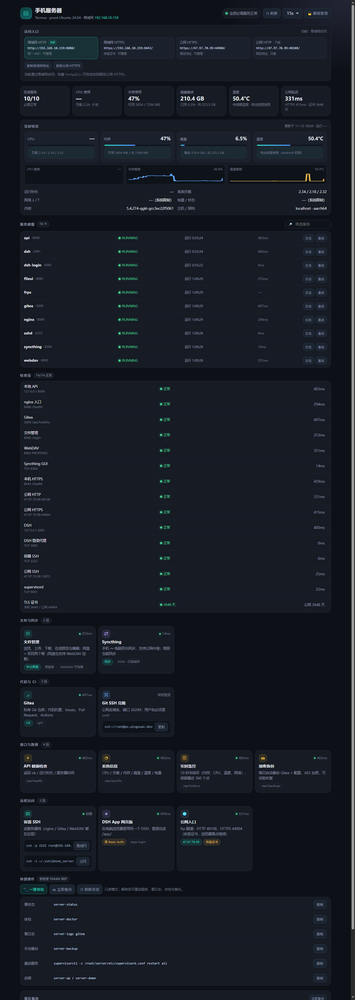

# 13 · 控制台页面功能分析与完善（v2）

> 日期：2026-11-10 16:50–17:20
> 对象：`http://192.168.10.143:8080/`（手机服务器控制台首页）
> 目标：分析现有功能，参考成熟自托管面板补齐「实时指标 / 服务管理 / 日志 / 检查项 / 管理操作 / 备份」能力。



---

## 1. 现状分析（改造前）

| 功能 | 现状 | 问题 |
|---|---|---|
| 系统概况 | 内存可用、磁盘剩余、公网延迟、服务在线 | 无 CPU、温度、运行时长、网络、电量；无趋势图 |
| 服务检查 | `/api/checks` 一次性拉取，卡片点状状态 | 只刷新一次；无服务列表、无延迟明细、无历史可用率 |
| 服务管理 | 仅“复制命令到 SSH 执行” | 不能在页面重启/启停、看日志；不符合成熟面板习惯 |
| 日志 | 无 | 出问题必须 SSH |
| 备份 | 列表展示（有则显示） | 实为**坏的**：`sqlite3` 未安装，`server-backup` 必失败；无触发按钮 |
| 动作操作 | 无 | 无确认、无权限控制、无审计 |
| 刷新 | 页面加载一次 | 数据会过期；无手动/自动刷新控制 |
| 权限 | 页面只读公开 | 一旦加操作，需管理鉴权/防 CSRF/公网暴露风险 |
| 缓存 | 无 Cache-Control | 更新页面后浏览器可能拿旧壳 |
| 移动端 | 基础响应式 | 新增管理功能需要移动端可用 |

### 1.1 平台限制（必须如实处理）

proot 内 App UID 无法读取 Android 的 `/proc/stat`、`/proc/uptime`、`/proc/net/dev`、`/sys/class/power_supply`：

- CPU/负载：`os.getloadavg()` 可用；精确 CPU 由 Termux 侧采集；
- 运行时长：`/proc/uptime` 被拒 → 由 Termux 侧 `uptime` 采集；
- 电池、网络速率：Android 权限受限 → 页面显示“系统限制/不可用”，不伪造 0；
- 温度：`/sys/class/thermal` 可读（实际验证 37°C）。

## 2. 参考的成熟项目

| 项目 | 借鉴的成熟模式 | 本项目落地 |
|---|---|---|
| [Portainer](https://github.com/portainer/portainer) | 服务/容器生命周期操作、日志查看、二次确认 | 服务行“日志/重启”，确认弹层 + supervisorctl |
| [Cockpit](https://github.com/cockpit-project/cockpit) | 系统总览 + 服务 + 日志 + 管理鉴权 | `/api/overview` 聚合、管理 token、日志查看器 |
| [Uptime Kuma](https://github.com/louislam/uptime-kuma) | 探活状态、延迟、可用率 | `/api/checks` 并行探测、延迟展示、检查项列表 |
| [Netdata](https://github.com/netdata/netdata) / [Grafana](https://github.com/grafana/grafana) | 实时指标与趋势图 | 10 秒内存采样环 + CPU/内存/温度 sparkline |
| [Homepage](https://github.com/gethomepage/homepage) / [Dashy](https://github.com/Lissy93/dashy) / [Homarr](https://github.com/homarr-labs/homarr) | 服务导航 + 状态卡片 + 搜索 | 原有服务卡片保留、服务健康列表 + 筛选 |
| [Beszel](https://github.com/henrygd/beszel) / [Glances](https://github.com/nicolargo/glances) | 资源仪表、限制友好展示 | 指标卡 + 进度条 + “系统限制”占位 |
| [Nginx Proxy Manager](https://github.com/NginxProxyManager/nginx-proxy-manager) | 证书有效期 | 检查项展示本机/公网 TLS 剩余天数 |

> 以上只借鉴产品模式与信息架构，不复制其代码；控制台继续保持**零依赖、静态 HTML/CSS/JS**，便于在手机端运行。

## 3. 本次实现的功能

### 3.1 后端 API v2（`scripts/server/console-api.py` → `/root/server/api/app.py`）

| 路由 | 说明 |
|---|---|
| `GET /api/overview?n=` | 前端一次请求拿到 sysinfo + checks + services + history + backups |
| `GET /api/sysinfo` | CPU（Termux 采集）、负载、内存、磁盘、温度、电量/网络（受限时 null）、运行时长 |
| `GET /api/history?n=` | 10 秒采样环（最多 360 点），CPU/内存/温度/网络 |
| `GET /api/checks` | 并行探活：本机/公网 HTTP(S)、DSH、SSH、supervisord、SSL 证书天数 |
| `GET /api/services` | supervisord 状态 + 端口 + 健康延迟 + 是否可看日志 |
| `GET /api/logs?name=&lines=` | 服务日志 tail（DTOKEN + HTTPS/局域网限制） |
| `GET /api/backups` | 最近加密备份 |
| `GET /api/meta` | 版本、LAN/HTTPS、是否需管理 token |
| `POST /api/action` | 管理操作：`restart/start/stop` 服务、`doctor`、`backup`；需 `X-Console-Token` |

### 3.2 前端仪表盘

- 顶部：整体状态、手动刷新、自动刷新（5/15/30/60s/停止）、解锁管理；
- 6 个指标卡：在线服务、CPU、内存、磁盘、温度、公网延迟；
- 实时状态面板：CPU/内存/磁盘/温度进度条 + CPU/内存/温度 sparkline + 运行时长/负载/网络/电池/内核；
- 服务健康：11 个 supervisord 服务，状态/端口/运行时长/健康延迟，搜索、日志、重启；
- 检查项：14 项探活 + 本机/公网 TLS 证书剩余天数；
- 快捷操作：一键体检、立即备份、刷新；
- 原有服务卡片、远程访问、运维命令全部保留；
- 备份面板：加密备份列表 + 立即备份；
- 日志查看器：选择服务、200/500/1000 行、自动跟随、复制、下载；
- 管理解锁弹层：token 只存 sessionStorage；确认弹层；Toast；
- 可见性暂停自动刷新、移动端/桌面响应式、无外部依赖。

### 3.3 平台采集与修复

- 新增 `scripts/server/termux-metrics.sh`：Termux 侧每 10 秒用 `/system/bin/top` + `/system/bin/uptime` 采集，写 `$HOME/server-metrics.txt`；proot API 通过 `/hosthome` 读取，解决 CPU/uptime 不可读；
- `scripts/server/00-server.sh` 已加入采集器自启动；
- **修复备份失败**：安装 `sqlite3`（3.45.1），非交互执行 `dpkg --force-confold --configure -a` 修正 nginx 包状态；当前备份已成功：`server-20261110-1717.tar.gz.enc`（6.45 MB）。

## 4. 安全模型

| 风险 | 措施 |
|---|---|
| 公网可读页面 | 只读指标/检查公开；日志、操作需管理 token |
| 公网 HTTP 窃取 token | 管理操作/日志额外要求 **HTTPS 或私网 Host**；公网 HTTP 返回 403；建议用 `https://47.97.70.99:44904/` |
| CSRF/直连 | 管理 token 放请求头，不靠 cookie；前端额外带 `X-Requested-With` |
| 操作误触 | 二次确认；服务名白名单；每秒 1 次限流 |
| 审计 | 每次操作写 `/root/server/logs/console-actions.jsonl` |
| 日志泄露 | 日志接口要求 token + HTTPS/局域网 |
| 页面旧缓存 | 首页与 DSH `/app/` 均 `Cache-Control: no-store` |
| Token 泄露 | 文件 `/root/server/etc/console-action.token`（600）；可随时 `openssl rand -hex 24 >` 轮换 |

## 5. 验证结果

| 检查 | 结果 |
|---|---|
| 服务 | **11/11 RUNNING**（含 dsh、dsh-login） |
| `/api/overview` | 200，约 0.4s（探活缓存并行） |
| 检查项 | **14/14 正常**；本机/公网证书剩余 3648 天 |
| 页面渲染 | Edge 真实渲染 **60,802 DOM / 53,066 字节**（截图 1280×3600）；`Cache-Control: no-store` |
| 管理操作 | 无 token 401；局域网+token doctor 200；公网 HTTP 403；公网 HTTPS 200 |
| 日志 | 无 token 401；token 200（内容正常） |
| 备份 | “立即备份” 200；生成 `server-20261110-1717.tar.gz.enc` 6.45MB；列表接口可见 |
| 移动端 | 1280px 截图完整；<480px 走 2 列/单列断点 |
| 指标 | CPU/内存/磁盘/温度/运行时长正常；电池/网络因 Android 权限显示“系统限制” |

> 运行时长/CPU 由 Termux 采集器提供；若采集器停止，页面显示旧值/受限，不会伪造。

## 6. 回滚

```bash
# API / 页面（服务器上已有备份）
cp -a /root/server/api/app.py.bak-console-v2-20261110-1655 /root/server/api/app.py
cp -a /root/server/www/index.html.bak-console-v2-20261110-1655 /root/server/www/index.html
cp -a /etc/nginx/sites-available/dsh-server.bak-console-v2-20261110-1710 /etc/nginx/sites-available/dsh-server
supervisorctl -c /root/server/etc/supervisord.conf restart api
nginx -t && nginx -s reload
# 停用指标采集器
pkill -f termux-metrics.sh
# 从 boot 脚本移除采集器启动行（或恢复 00-server.sh 备份）
```

管理 token 可随时更换；更换后已解锁的浏览器需重新输入。

## 7. 后续可扩展

- 接入 Uptime Kuma/Prometheus 做长周期可用率与告警；
- 服务日志轮转状态/搜索/关键字高亮；
- 备份校验与恢复按钮；
- 用户/角色（目前单管理员 token 已满足个人服务器）；
- 接入 Termux:API 获取电池/网络（需安装 Termux API 并授权）。

## 8. 变更记录

| 时间 | 变更 | 结果 |
|---|---|---|
| 16:50 | 分析旧页 + 定方案 | 见 §1/§2 |
| 16:55 | API v2 + 页面 v2 部署 | 11 服务、检查项正常 |
| 17:07 | Termux 指标采集器 | CPU/运行时长可用 |
| 17:17 | 修复 sqlite3/备份 | 备份 6.45MB 成功 |
| 17:18 | Edge 截图验收 | 见上，功能完整 |
