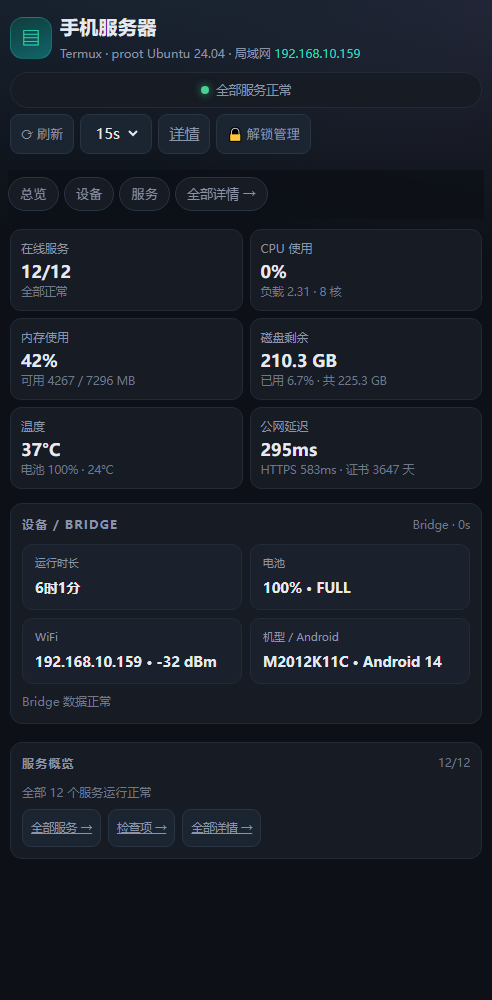
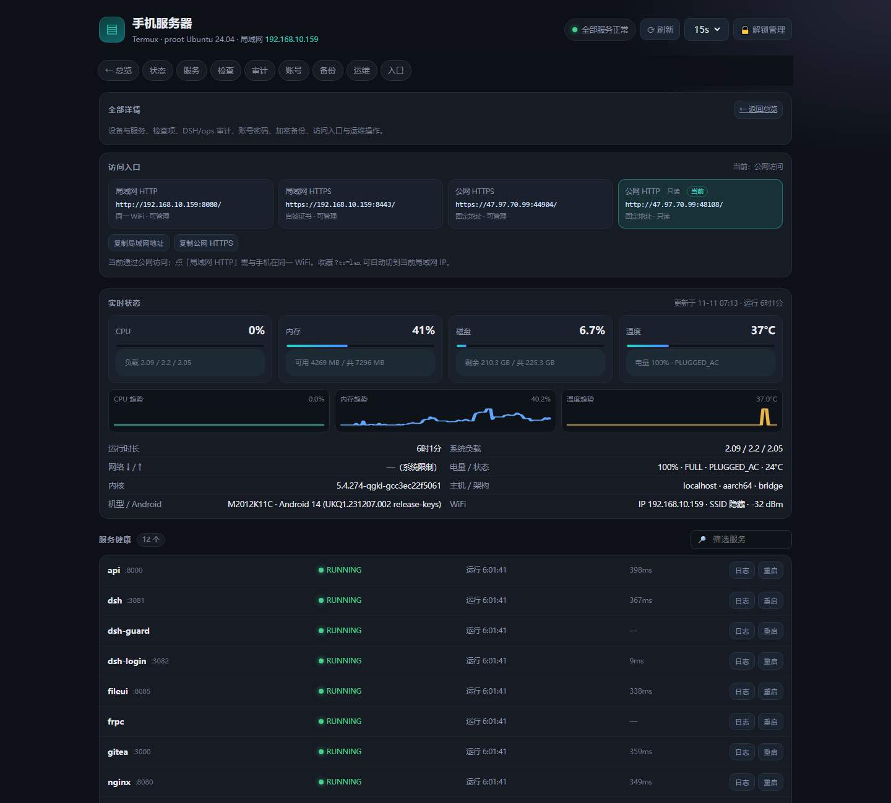

# 34 · Console 总览/详情改版

> 日期：2026-11-11
> 范围：仅控制台前端信息架构；不改 API、不改服务器服务。
> 目标：主页只保留核心摘要；完整服务/检查/审计/账号/备份/入口/运维收进详情页。

---

## 1. 改版结果

| 视图 | URL | 内容 |
|---|---|---|
| **总览** | `/` | 6 个核心指标（服务/CPU/内存/磁盘/温度/公网延迟）、设备/Bridge 摘要、服务概览、详情入口 |
| **详情** | `/?view=details` | 访问入口、完整实时状态（趋势+明细）、全部服务、检查项、DSH/ops 审计、账号密码、备份、外部入口、快捷运维 |

- 总览不再渲染长列表；
- 详情页保留所有原功能与 ID，管理 token、日志、备份、保险库、重启按钮均不变；
- 详情页顶部有 **返回总览** 和章节导航（桌面/手机均可见）；
- 主页面顶部/导航均有 **详情** 入口；
- `?view=details#services-group` 可直接定位到章节（hash 只滚动一次，避免自动刷新时重复跳回）。

### 截图

**总览（桌面）**

**详情（桌面）**

---

## 2. 实现方式

- 单文件 `index.html` 双视图：
  - `body.main-mode` / `body.details-mode` 由 `?view=details` 切换；
  - CSS：`body.main-mode .detail-only { display:none }`，`body.details-mode .main-only { display:none }`；
  - 新增总览组件：`#device-card`（运行时长/电池/WiFi/机型 + Bridge 来源）、`#service-summary`（运行数/异常服务/详情入口）；
  - 详情组件保留原 `#access-card`、`#live-card`（趋势/明细）、`#services-group`、`#checks-group`、`#ops-audit-group`、`#vault-group`、`#bak-card`、`#ops-group`、入口卡片与提示。
- JS 改动：
  - `DETAIL_MODE` 常量 + body class 切换 + 详情页标题；
  - `renderOverview` 增加总览摘要渲染（Bridge 来源、电池/WiFi/设备、服务异常）；
  - `scrollCurrentHash`（只执行一次）；
  - 导航点击处理覆盖 `#jump` 与 `#detail-nav` 两套。

---

## 3. 验证

| 检查 | 结果 |
|---|---|
| JS 语法 | `node --check` 通过 |
| 总览页面 | 200，包含 `main-mode`/`device-card`/`service-summary` |
| 详情页面 | 200，包含 `detail-nav`/`detail-hero` |
| 详情导航 | 桌面/手机均显示，章节可跳转 |
| 横向溢出 | Edge headless 实测 `innerWidth=492 / scrollWidth=492 / wrap=472`，无横向溢出（Chrome headless 最小窗口约 492；390 截图裁切是缩放伪影） |
| 管理功能 | 解锁/日志/备份/保险库/重启按钮保留 |
| 数据 | 仍使用 `/api/overview`、`/api/ops`、`server-ops bridge status`；Bridge source=bridge |

> 说明：截图使用 Edge headless（桌面 1440px / 窄屏 492px）。真实手机 390px 下栅格为 2 列/2 行，原移动端适配继续生效。

---

## 4. 回滚

- 页面仅前端：`git checkout <改版前提交> -- scripts/server/console/index.html`，重新 scp 到 `/root/server/www/index.html`；
- 无需重启 API/nginx；
- 详情数据接口未改，回滚不影响 Bridge/服务器。

---

## 5. 后续可选

- 总览可加一个“常用入口”短行（文件/Gitea/DSH）——当前保持极简，未加；
- 详情页可加“检查项异常置顶”排序；
- 如需独立 URL，可加 `/details` nginx alias（当前用 `?view=details` 已满足）。
