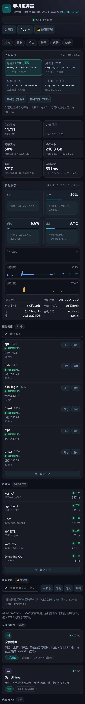

# 17 · 控制台移动端适配与显示逻辑优化

| 项目 | 内容 |
|---|---|
| 文档 ID | `HB-CON-017` |
| 版本 | v2.0（2026-11-11） |
| 状态 | 现行（移动端适配；随 34 双视图继续生效） |
| 关联 | [34 Console 总览/详情改版（当前 IA）](34-Console总览详情改版.md) · [13 控制台功能分析与完善](13-控制台功能分析与完善.md) · [26 手机状态数据来源](26-Console手机状态补全.md) · [当前状态](../00-overview/当前状态.md) |

> **视角说明**：本文是**移动端适配**篇（布局断点、折叠、跳转、抽屉），不是 Console 现状总述；当前信息架构（总览 + `?view=details`）见 [34](34-Console总览详情改版.md)，功能/API 见 [13](13-控制台功能分析与完善.md)。本文的移动端规则在 2026-11-11 双视图改版后**继续生效**。

> 日期：2026-11-10 19:24–19:35
> 目标：手机浏览器上控制台不再横向溢出、重排更合理；长页面/长列表改为可折叠、可快速跳转；桌面端保持不变。

---

## 1. 移动端问题（改造前）

| 问题 | 原因 |
|---|---|
| 页面右侧被裁、横向溢出 | 访问入口 `minmax(190px,1fr)` 两列超过 390px 可用宽度；部分网格 `auto` 列按 max-content 撑宽 |
| 头部控件挤成一行/被裁 | `head-right` 未强制换行；总宽度超过窄屏 |
| 服务/检查行错位 | 桌面 5 列/4 列网格直接照搬到窄屏 |
| 弹层在手机上过高/难操作 | 居中大弹窗，底部按钮可能被键盘/安全区遮挡 |
| 页面非常长 | 11 个服务 + 约 15 检查项 + 9 个账号全部平铺（2026-11-10 快照；当前 12 个服务），滚动负担大 |
| 找不到区块 | 没有页内导航 |

## 2. 本次改动

### 2.1 布局适配（≤600px）

- `html/body/.wrap` 宽度约束；**访问入口 2 列 `minmax(0,1fr)`**，≤359px 变 1 列；
- 指标卡 2 列；资源仪表 2 列；趋势图 1 列；详情 2 列；
- **文件/代码/接口/远程等卡片在手机上 1 列**，描述最多 2 行；
- 服务/检查/账号行改为**两列网格 + grid-area 分区**（名称/状态/运行时长/延迟/操作各占一行或固定列）；
- 头部：状态一行，刷新/间隔/解锁管理另起一行，按钮最小高度 40px；
- 弹层改为**底部抽屉**：全宽、92vh 上限、底部按钮 sticky + 安全区 padding；
- 导航：新增**吸顶快速跳转条**（状态/服务/检查/账号/运维/备份），Shell 横向滚动；
- 触屏热区：工具按钮、复制按钮加大；保留 `:focus-visible`。

### 2.2 显示逻辑优化（移动端）

| 逻辑 | 说明 |
|---|---|
| **长列表折叠** | 移动端服务默认显示 6 项、检查 6 项、账号 5 项；底部「展开其余 N 项」/「收起列表」 |
| **搜索先于折叠** | 先按搜索/筛选结果计算总数，再进行折叠；展开状态在自动刷新后保留 |
| **页内导航** | 吸顶 buttons → `scrollIntoView` + `scroll-margin-top`；当前按钮高亮 |
| **响应式重算** | 窗口尺寸变化后重新渲染列表（去抖 160ms），避免折叠数量停留在旧尺寸 |
| **刷新逻辑不变** | 仍按 5/15/30/60s 自动刷新；页面隐藏时暂停；手动刷新/解锁不影响折叠状态 |
| **桌面不变** | >600px 仍显示全部列表、隐藏 jump 导航，布局与原来一致 |

## 3. 验证结果（2026-11-10 快照）

使用 **真实移动设备模拟**（CDP `Emulation.setDeviceMetricsOverride`，非 `--window-size` 的假窗口）：

| 检查 | 结果 |
|---|---|
| 390 CSS px `innerWidth` | 390 |
| `document.documentElement.scrollWidth` | **390（无横向溢出）** |
| 超宽元素扫描（right > 390 + 1） | **0 个** |
| 移动端初始列表 | 服务 6、检查 6、折叠按钮 2 个 |
| 点「展开其余」 | 服务 11、检查 15；按钮变为「收起列表」 |
| Jump 导航 | 点击「服务」后 `scrollY: 0 → 1400` |
| 桌面 1280px | `scrollWidth=1265`、jump 隐藏、服务 11、检查 15；无回归 |

> 与 [34](34-Console总览详情改版.md) 的衔接：34 的窄屏截图用 Edge headless（最小窗宽约 492px，390px 图是缩放伪影）；**真实 390px 布局与折叠规则以本文 CDP `Emulation.setDeviceMetricsOverride` 实测为准**（无横向溢出）。双视图改版（总览/详情）后这些规则继续生效。

## 4. 文件与回滚

| 文件 | 说明 |
|---|---|
| [`scripts/server/console/index.html`](../../scripts/server/console/index.html) | 移动端 CSS + 折叠/导航逻辑（已部署 `/root/server/www/index.html`） |
| [console-mobile.png](../assets/console-mobile.png) | 390×844 真实移动端截图（2026-11-10 版本） |

回滚：使用服务器上部署前备份 `/root/server/www/index.html.bak-console-v2-20261110-1655` 恢复后覆盖即可。

## 5. 后续可选

- 移动端按需加载/只刷新当前可见区块（目前全局刷新）；
- 折叠状态持久化到 localStorage；
- 底部安全区下的悬浮“回到顶部”按钮；
- 未来的深色/浅色主题切换（当前固定深色）。

## 6. 变更记录

| 时间 | 变更 | 结果 |
|---|---|---|
| 19:24 | 基线：真实移动视口发现右侧裁切/无折叠/无导航 | — |
| 19:28 | 添加移动端媒体查询、网格重排、底部抽屉、折叠逻辑、jump 导航 | 页面部署 |
| 19:31 | 真实 390px 模拟验证 | 无横向溢出；服务/检查折叠、展开正常 |
| 19:33 | 桌面 1280px 回归验证 | jump 隐藏、11/15 完整显示 |
